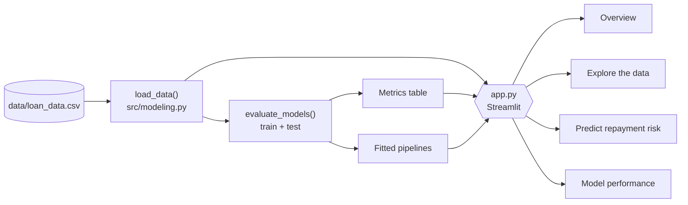
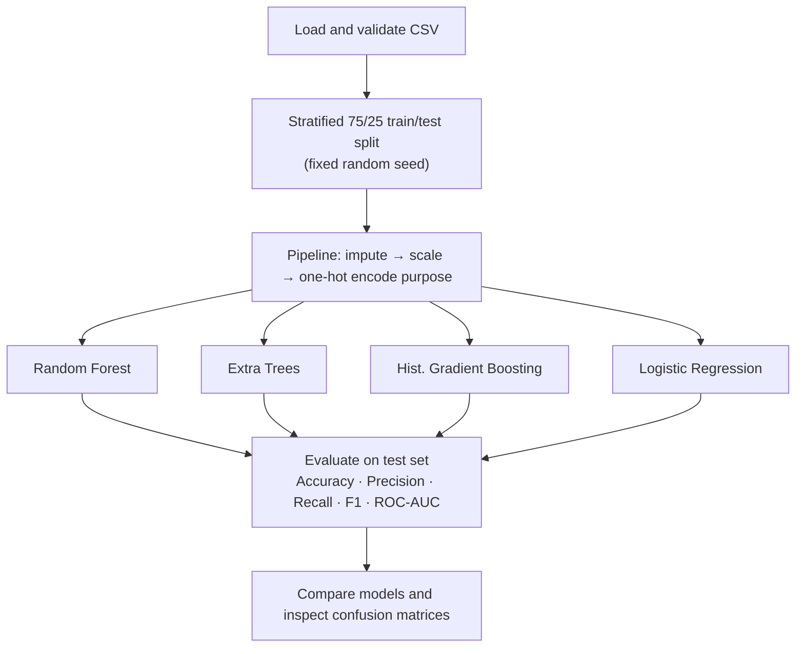
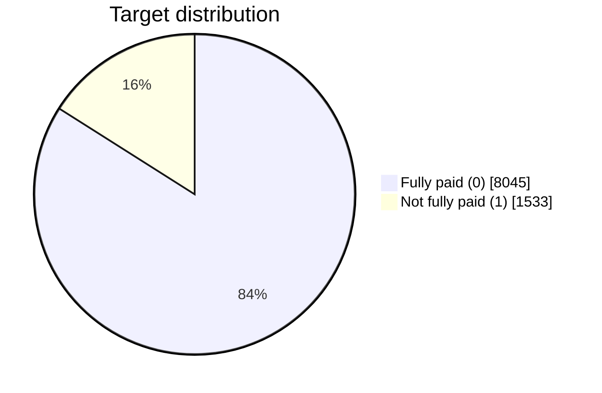

<div align="center">
# 📊 LoanLens
 
### Loan repayment risk explorer built with machine learning and Streamlit
 


 
</div>
---
 
## 📖 Overview
 
**LoanLens** is a local Streamlit web app built from the *Loan Repayment Prediction Using Ensemble Learning Methods* notebook and a LendingClub-style dataset. It offers descriptive analytics, a comparison of baseline classifiers, and a form that produces an illustrative risk estimate for a hypothetical applicant.
 
> ⚠️ **Not a credit decision system.** The target is the historical column `not.fully.paid`. It does not say whether a new loan should be approved. Do not use it for real lending, pricing or eligibility decisions.
 
---
 
## ✨ Features
 
| Page | What it does |
|------|--------------|
| 🏠 **Overview** | Dataset metrics, target distribution donut chart, model comparison snapshot, workflow summary |
| 🔍 **Explore the data** | Loan purpose by outcome, FICO histogram, interest rate box plot, correlation heatmap, data preview, CSV download |
| 🎯 **Predict repayment risk** | Form for a hypothetical applicant, model selector, classification, probability and gauge chart |
| 📈 **Model performance** | Metric table, grouped bar chart, per-model confusion matrix |
 
- Models compared: **Random Forest**, **Extra Trees**, **Histogram Gradient Boosting**, **Logistic Regression**
- Metrics: accuracy, precision, recall, F1, ROC-AUC
- Runs fully locally; no applicant input is sent to an external service
---
 
## 🧭 How the app is organised
 

 
---
 
## 🔬 Modelling workflow
 

 
Preprocessing lives inside each scikit-learn pipeline, so it is fitted on the training split only (no test-set leakage).
 
---
 
## 🗂️ Dataset
 
| Property | Value |
|----------|-------|
| Records | 9,578 |
| Columns | 14 (13 features + target) |
| Target | `not.fully.paid` (0 = fully paid, 1 = not fully paid) |
| Class balance | 8,045 fully paid · 1,533 not fully paid (≈ 84% / 16%) |
 

 
**Input features:** `credit.policy`, `purpose`, `int.rate`, `installment`, `log.annual.inc`, `dti`, `fico`, `days.with.cr.line`, `revol.bal`, `revol.util`, `inq.last.6mths`, `delinq.2yrs`, `pub.rec`
 
> Because the classes are imbalanced, accuracy alone is misleading. The original notebook reports roughly 85% accuracy for tree ensembles, but its gradient-boosting results show very low recall on the not-fully-paid class. That is why this app reports precision, recall, F1 and ROC-AUC alongside accuracy.
 
---
 
## 📁 Project structure
 
```text
Loan_Repayment_Prediction/
├── app.py                  # Streamlit UI (4 pages)
├── requirements.txt
├── run_windows.bat         # one-click setup + run (Windows)
├── run_mac_linux.sh        # one-click setup + run (macOS / Linux)
├── PROJECT_ANALYSIS.md     # notes on the supplied notebook and data
├── data/
│   └── loan_data.csv
├── src/
│   └── modeling.py         # load_data, build_pipeline, evaluate_models
└── notebooks/
    └── original_loan_repayment_notebook.ipynb
```
 
---
 
## 🚀 Getting started
 
**Prerequisite:** Python 3.10 or 3.11.
 
### Quick start
 
| OS | Command |
|----|---------|
| Windows | Double-click `run_windows.bat` |
| macOS / Linux | `chmod +x run_mac_linux.sh && ./run_mac_linux.sh` |
 
### Manual setup
 
```bash
# 1. Create and activate a virtual environment
python -m venv .venv
source .venv/bin/activate          # Windows: .venv\Scripts\activate
 
# 2. Install dependencies
python -m pip install --upgrade pip
pip install -r requirements.txt
 
# 3. Run the app
python -m streamlit run app.py
```
 
Then open the address printed in the terminal, usually <http://localhost:8501>.
 
The first launch trains the models, so expect a short wait; results are cached afterwards.
 
---
 
## 🧰 Tech stack
 
| Purpose | Library |
|---------|---------|
| Web app | Streamlit (`>=1.35,<2.0`) |
| Data | pandas, NumPy |
| Modelling | scikit-learn (`>=1.4,<2.0`) |
| Charts | Plotly (`>=5.20,<7.0`) |
 
---
 
## 📸 Screenshots
 
Add screenshots after running the app, for example under `docs/screenshots/`:
 
| Overview | Explore | Predict | Performance |
|:--:|:--:|:--:|:--:|
| _add image_ | _add image_ | _add image_ | _add image_ |
 
---
 
## ⚠️ Limitations
 
- Classroom/demo project; not independently validated, calibrated or approved for real-world financial use.
- Historical lending data can contain bias, missing context and outdated relationships.
- Charts show associations, not causation.
- The probability shown for a hypothetical applicant may be poorly calibrated.
- Avoid using any output for loan eligibility, pricing or credit access.
---
 
<div align="center">
Student ML project · Uses the provided LendingClub-style loan dataset · No data leaves your machine
 
</div>
 
